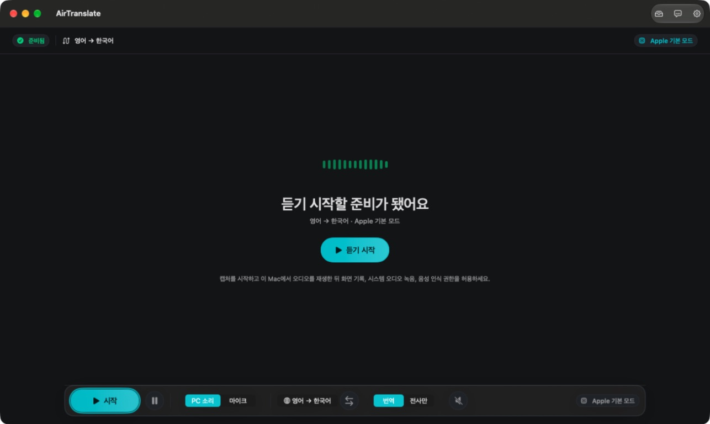

<p align="center">
  
</p>

# AirTranslate

会議、動画、講義、インタビュー、配信向けのMac音声ライブ字幕と翻訳アプリ。

<p align="center">
  <a href="https://github.com/himomohi/AirTranslate/releases/latest/download/AirTranslate.dmg"></a>
  <a href="https://github.com/himomohi/AirTranslate/releases/latest"></a>
  <a href="LICENSE"></a>
</p>

<p align="center">
  <a href="README.md">English</a> ·
  <a href="README.ko.md">한국어</a> ·
  日本語 ·
  <a href="README.zh-CN.md">中文</a> ·
  <a href="CHANGELOG.md">変更履歴</a> ·
  <a href="docs/GETTING-STARTED.md">はじめに</a>
</p>

AirTranslateはMacで再生中の音声を取り込み、ライブで文字起こしし、翻訳ワークフローを選んだ場合は翻訳し、必要に応じて他のアプリの上にフローティング字幕を表示します。Apple Modeは引き続きローカル優先の標準ワークフローです。クラウドエンジンは任意で、対応するプロバイダーキーを設定すると利用できます。

## ダウンロード

現在の公開最新版: **v1.20.0**。

- [AirTranslate.dmgをダウンロード](https://github.com/himomohi/AirTranslate/releases/latest/download/AirTranslate.dmg)
- [AirTranslate-1.20.0.zipをダウンロード](https://github.com/himomohi/AirTranslate/releases/download/v1.20.0/AirTranslate-1.20.0.zip)
- [AirTranslate.dmg.sha256をダウンロード](https://github.com/himomohi/AirTranslate/releases/latest/download/AirTranslate.dmg.sha256)
- [AirTranslate 1.20.0 リリースノート](https://github.com/himomohi/AirTranslate/releases/tag/v1.20.0)
- [バージョン履歴を見る](Release/VERSION-HISTORY.md)

オープンソースのDMGとZIPはad-hoc署名で、Appleの公証を受けていません。初回起動がブロックされた場合は[インストールガイド](docs/GETTING-STARTED.md)を確認してください。DMGのハッシュは次のように確認できます。

```bash
shasum -a 256 AirTranslate.dmg
cat AirTranslate.dmg.sha256
```

## アプリのアップデート

メインウインドウの左下に現在のバージョンが表示されます。選択すると最新の安定版を確認できます。新版がある場合はリリースノートを確認するか、**アップデートをダウンロード** で公式 DMG を検証してから開き、「アプリケーション」のアプリを置き換えます。

## 実際のアプリ



キャプチャ開始前のAirTranslateワークスペースです（韓国語UI）。

AirTranslateは原文の文字起こしと翻訳文を1つのワークスペースに保ち、別のアプリで視聴または作業している間はフローティング字幕で表示できます。

## 3ステップで開始

1. アプリをインストールし、実際に使うコピーを起動して、macOSが求める画面収録とシステムオーディオ録音の権限を許可します。
2. 原文言語と翻訳言語を選び、コンソールからApple Modeまたは任意のエンジンを選択します。
3. **Start**を押し、Macの音声を再生するかマイク入力を選び、メインワークスペースまたはフローティング字幕で読みます。

API連携エンジンは、**Settings > API Keys**でキーを設定すると利用できます。キー設定済みとはAirTranslateにローカルのプロバイダー設定があるという意味で、プロバイダーのアクセス権はセッション開始時に確認されます。

## 主な機能

- ScreenCaptureKitによるシステムオーディオ取り込みと、内蔵、Bluetooth、AirPodsマイク入力。
- ローカル優先の標準経路であるApple Speech文字起こしとApple Translation翻訳。
- 翻訳なしで原文字幕だけを見る文字起こし専用モード。
- フローティング字幕、保存済み記録ライブラリ、任意の翻訳音声、ワンクリック言語入れ替え。
- 文字だけのフローティング字幕と、設定での5スタイル・フォント・色・幅・行間・順序・プレビュー・保存・リセット。
- 記録ファイル保存はデフォルトでオフです。Application Supportに通常の`.txt`ファイルを残す場合は**Save Transcript Files**を有効にします。
- 英語、韓国語、日本語、簡体字中国語のアプリ言語。

## エンジン

| エンジン | 役割 | 必要なもの |
| --- | --- | --- |
| Apple Mode | 標準のローカル優先文字起こしと翻訳です。 | なし |
| OpenAI 音声 | 1つのプロバイダー内で翻訳または原文文字起こしを選びます。出力アイコンで `gpt-realtime-translate`・`gpt-live-transcribe` を切り替え、ツールチップでモデルと料金を確認できます。 | OpenAI |
| Gemini Live | 文書化されたリアルタイム翻訳モデル、または音声言語を自動検出する原文文字起こしモデルを選択できます。 | Gemini |
| Meta Scribe | AirTranslate翻訳の前段にある、話者ラベル付き多言語文字起こしです。 | Meta |
| Azure MAI | 5 秒 REST チャンクの MAI-Transcribe-2、または中間字幕付き MAI-Transcribe-2-Streaming と Apple 翻訳。 | リソースキーとエンドポイント。ストリーミングには Foundry デプロイ名も必要 |
| Nari STT | Nari Qwen3-ASR原文文字起こしです。マイクまたはMac音声を使えます。 | Nari |
| Grok STT | マイクまたはMac音声をGrok Voice Transcribe 2.0で原文に文字起こしします。 | SpaceXAI (xAI) |
| Qwen LiveTranslate | Qwen3.8は専用のリアルタイム翻訳モデルです。Qwen Audio 3.1 Realtime PlusはAirTranslateから翻訳指示を受ける全二重音声会話モデルで、音声応答を返せます。 | Alibaba CloudシンガポールのAPIキー。Qwen3.8にはワークスペースIDも必要 |

Qwen Audio 3.1 ASR Flash Filetransは、設定 > 一般で公開HTTPS音声URLから非同期で文字起こしします。QwenCloudがURLから音声を取得し、この機能はローカル音声ファイルをアップロードしません。

Grok STTを利用できます。初回選択は原文文字起こしで、自分のxAI APIキーを使用します。設定、言語処理、検証範囲は[Grok STTの説明](docs/grok-stt.md)をご確認ください。

Nari STTは任意のエンジンです。Nariの初回選択は原文文字起こしとして開始し、原文言語が利用できる場合はApple Translationで翻訳できます。Nariの現在のGA STTモデルIDはqwen3-asr-fastとqwen3-asrで、利用可否、利用制限、有料クレジット条件はNariのプロバイダー文書とアカウント状態に従います。詳細は[docs/nari-stt.md](docs/nari-stt.md)にまとめています。

Nariは韓国語を含む入力言語の手動選択と音声言語の自動検出に対応します。

Nariを新しく選択すると、Nariクレジットが必要なGA Fastモデルを使用します。保存済みのFree Public Betaモデルの選択は保持して開始をブロックし、有料モデルへ自動移行しません。設定 > 一般で課金の案内を確認し、GAモデルを明示的に選択するとNari STTを再開できます。

## フローティング字幕

フローティング字幕は、画面に原文・翻訳の文字だけを重ねます。背景・枠・ツールバー・状態表示・サイズ変更の印は、ポインタを重ねても表示しません。字幕がないときは何も表示しません。設定・メイン画面・メニューバーで操作し、⌘⇧Cで字幕の表示を切り替えます。

標準・映画・講義・高コントラスト・明るい画面用の5つの文字スタイル、4種類のフォント、太さ・行間・影/縁取り・文字色・配置・行数・翻訳を上に表示する設定を用意しています。明暗のサンプル画面で実際の18–72ptサイズを確認し、録音せずにサンプル字幕を表示できます。幅と最前面表示は設定で変更します。既存の外観設定は復元しますが、以前の背景設定が残っていてもウインドウ背景は表示しません。

## Microsoft MAI 音声

Azure MAI で **MAI-Transcribe-2-Streaming** を選ぶと中間の原文字幕を表示します。API キー設定に Microsoft Foundry リソースのエンドポイント（`https://<resource>.services.ai.azure.com`）、同じリソースのキーとデプロイ名を入力してください。3 秒ごと、および一時停止・停止時に音声を確定し、確定テキストを Apple で翻訳します。従来の 5 秒単位の MAI-Transcribe-2 も選択できます。

翻訳音声出力で **MAI-Voice-2.1** または **MAI-Voice-2.1-Flash** を選び、**OpenRouter** キーを保存してください。翻訳先の言語と公開音声一覧に合う音声を使用します。韓国語に対応していますが、日本語は現在対応していません。音声生成には翻訳テキストのみを送信し、プロバイダー利用料金は別途発生します。[設定案内](docs/microsoft-mai-audio.md)。

Azure キャプチャの停止時は、制限時間内で最後の確定翻訳を待ちます。空の Azure 最終結果は、メイン画面とフローティング字幕の仮テキストを消去します。

## APIキー

APIキー画面は、**OpenAI**、**Gemini**、**Meta**、**Azure**、**Nari**、**SpaceXAI (xAI)** · **Alibaba Cloud (Qwen)** · **OpenRouter** · **TypeSafe (Jev)**を1つのプロバイダー一覧で管理します。各行には、設定/準備状態、プロバイダーアイコン、キー管理コンソールへのリンク、設定済みキーがプロバイダー権限の検証を意味しないことを説明する情報ポップオーバーが表示されます。

キーはmacOS Keychainに保存されます。AirTranslateにはアカウントシステム、開発者運用の中継サーバー、ハードコードされたプロバイダーキーは含まれていません。

GeminiキーはGemini Liveと任意のGemini翻訳音声出力で共有します。Gemini TTSを選択しても、実アカウントの権限、課金、品質、遅延が検証済みであることは意味しません。

## プライバシー

- EmbeddingGemma 2 ファイル文字起こしは要求時のみモデルをダウンロードし、音声と結果をアップロードせず端末内で処理します。
- Apple ModeはmacOSフレームワークとApple管理の言語アセットを使います。
- GPT、Gemini、Meta、Azure、Nari、Grok、Qwenモードは、選択した機能に必要な音声またはテキストだけを、ユーザーのキーで該当プロバイダーへ直接送信します。Gemini TTSはユーザーがGemini音声モデルを選んだ後、安定した翻訳テキストだけを送信します。
- 保存済み記録は、ファイル保存を有効にした場合にだけMac上の通常のテキストファイルとして残ります。
- より詳しいプロバイダーと保存の説明は[Release/PRIVACY-NOTICE.md](Release/PRIVACY-NOTICE.md)を参照してください。

## 必要条件

- macOS 26.0以降
- 任意の EmbeddingGemma 2 ファイル文字起こし: Apple Silicon・macOS 27 以降
- ソースビルド用Swift 6.4以降
- システムオーディオ取り込みに対応したMac
- Apple SpeechとApple Translationフレームワークが利用できる環境
- 任意: OpenAI、Gemini、Meta、Azure Speech、Nari、xAI、Alibaba Cloudのプロバイダーキー

## ドキュメント

- [Getting Started](docs/GETTING-STARTED.md)
- [Development](docs/DEVELOPMENT.md)
- [Nari STT notes](docs/nari-stt.md)
- [EmbeddingGemma 2 の手法とファイル文字起こし](docs/embeddinggemma-transcription.md)
- [変更履歴](CHANGELOG.md)
- [バージョン履歴](Release/VERSION-HISTORY.md)

<details>
<summary>ソースからビルド</summary>

```bash
./script/build_and_run.sh
./script/build_and_run.sh --verify
swift test
```

その他のコマンドは[docs/DEVELOPMENT.md](docs/DEVELOPMENT.md)にあります。

</details>

## コントリビュート

ユーザー向けのリリース履歴は[CHANGELOG.md](CHANGELOG.md)に保管します。READMEは過去のリリースノートを繰り返すのではなく、現在の製品、ダウンロード経路、プロバイダー境界を説明します。

## ライセンス

AirTranslateは[Apache License 2.0](LICENSE)で公開されています。著作権表記は[NOTICE](NOTICE)にあります。

AirTranslateは独立したオープンソースプロジェクトであり、Apple、OpenAI、Google、Meta、Microsoft、Nari、SpaceXAI (xAI)、Alibaba Cloudとは提携していません。
